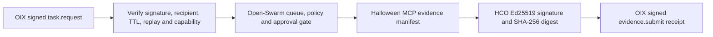

# Huffman Open Intelligence Workstream

Status reviewed: 2026-11-02. This index links the four public repositories in the Halloween 2026 engineering workstream. Each repository remains independently installable and independently licensed.

## Repository index

| Repository | Responsibility | License | Current state |
|---|---|---|---|
| [Open Intelligence Exchange (OIX)](https://github.com/HuffmanMainNode/Open-Intelligence-Exchange) | Signed agent identity and message envelopes, capability labels, TTL validation, in-memory and optional durable SQLite replay protection | MIT | Experimental v0.1; Python 3.11-3.13 CI |
| [Open-Swarm](https://github.com/HuffmanMainNode/-Open-Swarm) | Local SQLite task queue, lease ownership, approval workflow, policy checks, mock and optional Ollama adapters | MIT | Experimental v0.1; Python 3.11-3.13 CI |
| [Huffman Cyber Observatory (HCO)](https://github.com/HuffmanMainNode/Huffman-Cyber-Observatory) | Defensive local scanning, SHA-256 inventory, CycloneDX/SPDX JSON inventory, explicit-CVE CISA KEV correlation, encryption and Ed25519 artifact signatures | MIT | Experimental v0.1; Python 3.11-3.13 CI |
| [Halloween OSINT 2026](https://github.com/HuffmanMainNode/Halloween-OSINT-2026) | Evidence manifests, passive public-hostname DNS/TLS observation, offline transaction analysis, read-only EVM JSON-RPC inspection, stdio MCP tools | Apache-2.0 | Experimental v0.1; Python 3.11-3.13 CI |

## Architecture

The intended local integration path is:

A synthetic, in-process proof of this path lives in [examples/ecosystem_demo.py](../examples/ecosystem_demo.py). It uses temporary identities, a synthetic text fixture, a mock worker, a temporary SQLite replay database, and a temporary HCO signing key. It does not contact an external model, RPC node, or network service, and it does not execute the OIX payload.

## What is implemented

- OIX verifies signed envelopes, recipient identity, bounded TTL, and explicit capability labels. It offers a durable SQLite replay cache; the standalone two-process demo intentionally uses the in-memory cache.
- Open-Swarm persists tasks and audit events, uses lease IDs to reject stale workers, supports explicit approve/reject operations, and blocks tasks pending approval.
- Halloween OSINT provides root-scoped MCP file operations when `--root` or `HALLOWEEN_OSINT_ROOT` is configured. Its EVM inspection command remains CLI-only.
- HCO inventories CycloneDX/SPDX JSON SBOMs and correlates explicit CVE identifiers against a saved CISA KEV snapshot. It does not resolve package versions or prove exploitability.
- The synthetic integration demo connects these APIs locally and is exercised by a Python 3.11-3.13 GitHub Actions matrix.

## What is not implemented

- No OIX network relay, peer discovery service, or production transport.
- No OIX-to-Swarm production bridge or identity-to-worker trust registry.
- No distributed Open-Swarm scheduler, multi-tenant isolation, or OS-level execution sandbox.
- No automatic execution of received code or shell commands.
- No production key rotation/revocation service or hardware-backed key custody.
- No shared cross-host replay datastore.
- No full MCP/A2A conformance claim or third-party security certification.
- The synthetic approval step in the demo is a test fixture, not a human approval product.

## Shared-core decision

Do not extract a shared package yet. OIX Ed25519 identity signatures and HCO encrypted artifact-signing keys serve different lifecycle and trust-boundary purposes. The HCO and Halloween SHA-256 manifest formats also have different schemas and verification semantics. A premature shared package would create a compatibility dependency without a stable common contract.

The current integration demo deliberately tests the useful boundary that already exists: HCO signs the exact Halloween evidence-manifest bytes, and OIX signs a receipt containing that manifest's SHA-256 digest. It does not claim that the two manifest schemas are interchangeable. Revisit extraction only after a versioned common manifest schema and migration tests are agreed.

## Licensing policy

The current repository-specific licenses are retained: MIT for OIX, Open-Swarm, and HCO; Apache-2.0 for Halloween OSINT. No repository is relicensed by this index. New work should be placed in the repository whose license and ownership terms apply; do not copy code across repositories without preserving its license and notices.

## Release posture

The four repositories are experimental development projects. Green CI is evidence that the configured tests and static checks passed on the tested commit; it is not a security audit or certification. No v0.1.x release tags or signed release bundles are declared by this index. Before tagging, run each README command against the current default branch, review dependency advisories, generate an SBOM, sign release artifacts, publish checksums, and record known limitations.
